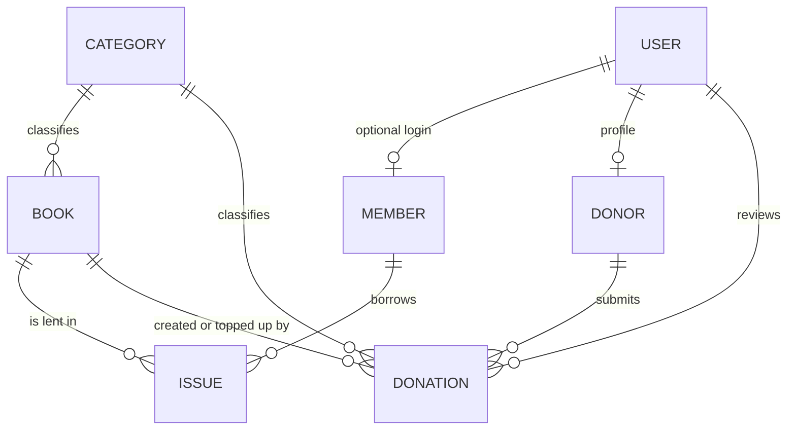

# Library Management System: Technical Documentation

A Django web application for running a small library: managing books and members, issuing and returning books with automatic fine calculation, accepting book donations with librarian approval, and generating reports.

---

## 1. Overview

### 1.1 Features

| Area | Capability |
|---|---|
| Authentication | Login and logout, donor self-registration, role-based access (Librarian, Member, Donor) |
| Books | Add, edit, delete, search by title, author or ISBN, filter by category and availability |
| Members | Add, edit, activate or deactivate, optional login account creation |
| Circulation | Issue and return books, per-member loan limit, due dates, overdue tracking |
| Fines | Automatic calculation on overdue days, fine recorded at return, mark-as-paid |
| Donations | Donor registration, donation requests, librarian approve or reject, automatic inventory update, donation history |
| Reports | Inventory, open and overdue loans, fines, member activity, donations, all with CSV export |
| Dashboard | Role-specific summary and quick actions |

### 1.2 Tech stack

- **Backend:** Django (Python), built-in auth and Groups
- **Database:** SQLite (development default)
- **Frontend:** Django templates with Bootstrap 5.3 (loaded from a CDN)
- **Config:** `python-dotenv` for environment variables

---

## 2. Project Structure

```
project-root/
├── manage.py
├── requirements.txt
├── .env                      # local secrets (not committed)
├── .env.example              # template for .env
├── .gitignore
├── config/
│   ├── settings.py
│   └── urls.py
├── templates/
│   ├── base.html             # shared layout and navbar
│   └── registration/
│       ├── login.html
│       └── register.html     # donor registration
└── library/
    ├── models.py             # data model and business logic
    ├── forms.py              # form validation
    ├── views.py              # request handlers
    ├── urls.py               # URL routes
    ├── permissions.py        # role helpers and decorators
    ├── context_processors.py # role flags available in every template
    ├── reports.py            # report definitions
    ├── admin.py
    ├── tests.py
    ├── management/commands/
    │   └── setup_groups.py   # creates the three role groups
    └── templates/library/    # app templates
        ├── dashboard.html
        ├── book_list.html / book_form.html / book_confirm_delete.html
        ├── member_list.html / member_form.html
        ├── issue_list.html / issue_form.html / my_loans.html
        ├── donation_form.html / my_donations.html / donation_list.html
        └── report_index.html / report.html
```

---

## 3. Setup and Running

```bash
# 1. Create and activate a virtual environment, then install dependencies
pip install -r requirements.txt

# 2. Create .env (copy .env.example and set a real secret key)
python -c "from django.core.management.utils import get_random_secret_key; print(get_random_secret_key())"

# 3. Create the database
python manage.py migrate

# 4. Create the role groups
python manage.py setup_groups

# 5. Create an admin account (treated as a librarian)
python manage.py createsuperuser

# 6. Run
python manage.py runserver
```

Open `http://127.0.0.1:8000/`.

### 3.1 Running the tests

```bash
python manage.py test library
python manage.py test library -v 2   # verbose
```

---

## 4. Configuration

### 4.1 Environment variables (`.env`)

| Variable | Purpose | Example |
|---|---|---|
| `DJANGO_SECRET_KEY` | Django secret key. Required when `DEBUG` is off. | long random string |
| `DJANGO_DEBUG` | `True` for development, anything else is off | `True` |
| `DJANGO_ALLOWED_HOSTS` | Comma-separated hostnames | `library.example.com` |
| `DJANGO_HTTPS` | `True` enables secure cookies, SSL redirect and HSTS | `False` |

If `DEBUG` is off and no secret key is set, the app refuses to start.

### 4.2 Application settings (`config/settings.py`)

| Setting | Default | Meaning |
|---|---|---|
| `LOAN_PERIOD_DAYS` | 14 | Days between issue date and due date |
| `FINE_PER_DAY` | 5 | Fine per overdue day (currency units) |
| `MAX_BOOKS_PER_MEMBER` | 3 | Maximum simultaneous open loans per member |
| `LOGIN_URL` | `login` | Redirect target for anonymous users |
| `LOGIN_REDIRECT_URL` | `dashboard` | After login |
| `LOGOUT_REDIRECT_URL` | `login` | After logout |
| `MEDIA_URL` / `MEDIA_ROOT` | `/media/`, `BASE_DIR/media` | Reserved for future uploads |
| `MESSAGE_TAGS` | maps `ERROR` to `danger` | Makes Django messages match Bootstrap alert classes |

The template context processor `library.context_processors.roles` must be listed in `TEMPLATES`. It provides `user_is_librarian`, `user_is_member` and `user_is_donor` to every template.

---

## 5. Roles and Permissions

Roles are Django **Groups**, created by `python manage.py setup_groups`.

| Role | How assigned | Can do |
|---|---|---|
| **Librarian** | Add a user to the `Librarian` group, or make them a superuser | Everything: manage books, members, issues, donations and reports |
| **Member** | Created by a librarian with "Create a login account" (added to `Member` group) | Browse and search books, view own loans |
| **Donor** | Self-registers at `/register/` (added to `Donor` group) | Browse and search books, submit donations, view own donation history |

A user with no group can log in but sees a "no role" message on the dashboard.

### 5.1 Access control helpers (`library/permissions.py`)

| Helper | Behaviour |
|---|---|
| `is_librarian(user)` | True for superusers or `Librarian` group members |
| `is_member(user)`, `is_donor(user)` | Group membership checks |
| `@librarian_required` | Login required, then 403 if not a librarian |
| `@donor_required` | Login required, then 403 if not a donor |

Anonymous users are redirected to the login page. Authenticated users without the right role receive HTTP 403.

---

## 6. Data Model



### 6.1 Models

**Category**: `name` (unique). Shared by books and donations.

**Book**

| Field | Type | Notes |
|---|---|---|
| `title`, `author` | text | |
| `isbn` | text, unique | |
| `category` | FK to Category | `PROTECT` |
| `total_copies` | positive int | |
| `available_copies` | positive int | Decremented on issue, incremented on return |
| `added_on` | datetime | auto |

**Member**

| Field | Type | Notes |
|---|---|---|
| `user` | one-to-one to User | optional, `SET_NULL` |
| `name`, `email` (unique), `phone`, `address` | | |
| `joined_on` | date | |
| `is_active` | bool | Deactivation replaces deletion |

**Issue** (a loan)

| Field | Type | Notes |
|---|---|---|
| `book`, `member` | FK | both `PROTECT` |
| `issue_date` | date | defaults to today |
| `due_date` | date | defaults to today + `LOAN_PERIOD_DAYS` |
| `return_date` | date, nullable | null means still out |
| `fine_amount` | decimal | set at return |
| `fine_paid` | bool | |

Methods and properties: `is_returned`, `calculate_fine(as_of=None)`.

**Donor**: one-to-one to User (`CASCADE`), `name`, `phone`, `address`, `registered_on`.

**Donation**

| Field | Notes |
|---|---|
| `donor` | FK to Donor |
| `title`, `author`, `isbn`, `category`, `condition`, `quantity` | Book details supplied by donor |
| `condition` | one of `new`, `good`, `fair`, `poor` |
| `status` | `pending` (default), `approved`, `rejected` |
| `submitted_on`, `reviewed_on`, `reviewed_by` | review audit trail |
| `remarks` | rejection reason |
| `book` | FK to the inventory record created or updated on approval |

Methods: `approve(librarian)`, `reject(librarian, remarks="")`.

### 6.2 Delete behaviour (referential integrity)

- A **Book** with loan history cannot be deleted (`PROTECT`). The UI shows an error.
- A **Member** is never deleted, only deactivated. Loan history stays intact.
- A **Category** in use by books or donations cannot be deleted.

---

## 7. Business Rules

### 7.1 Issuing a book

All checks run in `IssueForm`:

1. Only books with `available_copies > 0` are selectable.
2. Only active members are selectable.
3. A member cannot hold more than `MAX_BOOKS_PER_MEMBER` open loans.
4. A member cannot hold two open loans of the same book.

On issue, inside a database transaction with the book row locked (`select_for_update`), the loan is created and `available_copies` decreases by 1.

### 7.2 Returning a book

Inside a transaction with the loan row locked:

1. If already returned, nothing changes (so double-clicks cannot inflate stock).
2. `return_date` is set to today.
3. `fine_amount` is computed with `calculate_fine()` and stored.
4. `available_copies` is incremented using a database-side `F()` expression.

### 7.3 Fine calculation

```
fine = max(end_date - due_date, 0 days) * FINE_PER_DAY
```

- `end_date` is the return date if returned, otherwise today (or the `as_of` argument).
- A book returned on its due date has no fine.
- For open loans the fine is shown as "accruing" and is not stored until return.
- After return, the fine is frozen. Later dates do not change it.
- A librarian marks a fine as paid manually (`fine_paid`).

### 7.4 Donation workflow

1. A donor registers (creates User, Donor profile and Donor group membership in one transaction).
2. The donor submits a donation with title, author, ISBN, category, condition and quantity. Status is `pending`.
3. A librarian reviews the pending queue:
   - **Approve** calls `Donation.approve()`, which:
     - creates a new `Book` if the ISBN is new, using the donated quantity as total and available copies, or
     - adds the quantity to `total_copies` and `available_copies` if the ISBN already exists (no duplicate book), then
     - links the book to the donation and records reviewer and time.
   - **Reject** records the reviewer, time and optional remarks. No inventory change.
4. Only `pending` donations can be reviewed. Approving or rejecting an already-reviewed donation does nothing.
5. The donor sees all their donations and statuses under "My Donations".

### 7.5 Editing book copies

`BookForm` keeps availability consistent: when `total_copies` changes, copies currently on loan stay constant, and the form rejects a total lower than the number on loan.

### 7.6 Deactivating members

Toggling `is_active` on a member also toggles the linked `User.is_active`, so a deactivated member can no longer log in.

---

## 8. URL Reference

| URL | Name | Access | Purpose |
|---|---|---|---|
| `/` | `dashboard` | Logged in | Role-aware dashboard |
| `/login/` | `login` | Public | Login |
| `/logout/` | `logout` | Logged in (POST) | Logout |
| `/register/` | `register` | Public | Donor registration |
| `/books/` | `book_list` | Logged in | List, search, filter |
| `/books/add/` | `book_create` | Librarian | Add book |
| `/books/<id>/edit/` | `book_update` | Librarian | Edit book |
| `/books/<id>/delete/` | `book_delete` | Librarian | Delete book (confirm page) |
| `/members/` | `member_list` | Librarian | List and search members |
| `/members/add/` | `member_create` | Librarian | Add member, optional login |
| `/members/<id>/edit/` | `member_update` | Librarian | Edit member |
| `/members/<id>/toggle/` | `member_toggle_active` | Librarian (POST) | Activate or deactivate |
| `/issues/` | `issue_list` | Librarian | All loans, filters |
| `/issues/new/` | `issue_create` | Librarian | Issue a book |
| `/issues/<id>/return/` | `return_book` | Librarian (POST) | Return a book |
| `/issues/<id>/pay/` | `pay_fine` | Librarian (POST) | Mark fine paid |
| `/my-loans/` | `my_loans` | Logged in | Current user's loans (needs linked member record) |
| `/donate/` | `donation_create` | Donor | Submit donation |
| `/donations/mine/` | `my_donations` | Donor | Donation history |
| `/donations/` | `donation_list` | Librarian | Review queue |
| `/donations/<id>/approve/` | `donation_approve` | Librarian (POST) | Approve |
| `/donations/<id>/reject/` | `donation_reject` | Librarian (POST) | Reject |
| `/reports/` | `report_index` | Librarian | Report menu |
| `/reports/<name>/` | `report_view` | Librarian | View report, `?export=csv` to download |
| `/admin/` | | Staff | Django admin |

### 8.1 Search and filter parameters

| Page | Query parameters |
|---|---|
| `/books/` | `q` (title, author, ISBN), `category` (id), `available=1`, `page` |
| `/members/` | `q` (name, email, phone), `status` (`active`, `inactive`), `page` |
| `/issues/` | `q` (book title, member name), `status` (`active`, `overdue`, `returned`, `unpaid`), `page` |
| `/donations/` | `status` (`pending` default, `approved`, `rejected`, `all`), `page` |
| `/reports/fines/`, `/reports/donations/` | `start`, `end` (ISO dates, `YYYY-MM-DD`) |

All state-changing actions (return, pay, approve, reject, toggle, logout) require POST and a CSRF token.

---

## 9. Reports

Each report is a function in `library/reports.py` that returns `headers`, `rows` and `summary`. One view and one template render any report, and the same data feeds the CSV export.

| Key | Title | Date filter | Content |
|---|---|---|---|
| `inventory` | Book Inventory | No | Per title: total, available, on loan. Summary totals. |
| `open-loans` | Issued & Overdue Books | No | All open loans with days overdue and fine so far |
| `fines` | Fines | Yes (by return date) | Returned books with fines. Totals: fined, collected, outstanding |
| `members` | Member Activity | No | Loans (total, current) and fines (charged, unpaid) per member |
| `donations` | Donations | Yes (by submit date) | Donation history, counts by status, copies added to inventory |

**CSV safety:** cells beginning with `=`, `+`, `-` or `@` are prefixed with an apostrophe so spreadsheet software cannot execute user-entered text as a formula.

**Adding a report:** write a function returning `{"headers", "rows", "summary"}` and register it in the `REPORTS` dict. It appears in the menu automatically.

---

## 10. Dashboard

| Role | Content |
|---|---|
| Librarian | Cards: books out, overdue, pending donations, unpaid fines, titles, active members. Quick-action buttons. |
| Member | Current loans with due dates and fine so far, banner for unpaid fines |
| Donor | Pending donation count, latest five donations |
| No role | Warning to contact a librarian |

If a user belongs to several groups, the first match wins in this order: Librarian, Member, Donor.

---

## 11. Testing

`library/tests.py` covers:

| Test class | What it protects |
|---|---|
| `FineCalculationTests` | Not due, due today, overdue, returned on time, fine frozen after return, `as_of`, default due date, rate from settings |
| `LoanLimitTests` | Limit enforced, returned loans excluded, duplicate loan blocked, unavailable books and inactive members not selectable |
| `DonationApprovalTests` | New ISBN creates book, existing ISBN adds copies, double-approve safe, rejection, no re-review after decision |
| `ViewTests` | Issue reduces stock, late return saves fine, double-return safe, role restrictions (403), anonymous redirect, CSV formula neutralisation |

Tests use `@override_settings` for fine rate, loan period and loan limit, so they remain valid if you change those values. Django runs them on a temporary database.

---

## 12. Security Notes

- Secrets come from environment variables. `.env` and `db.sqlite3` are git-ignored.
- `DJANGO_HTTPS=True` enables `SECURE_SSL_REDIRECT`, secure session and CSRF cookies, and HSTS.
- Server-side role checks on every protected view. Hiding a link in the navbar is cosmetic only.
- Passwords are validated with Django's password validators when a librarian creates a member login. Donors register through `UserCreationForm`, which applies the same validators.
- Destructive or state-changing actions are POST-only with CSRF protection.
- CSV exports guard against formula injection.

---

## 13. Known Limitations

- **Row locking on SQLite.** `select_for_update()` has no effect on SQLite. The protection against two librarians issuing the last copy simultaneously takes effect on PostgreSQL or MySQL.
- **Fines are stored at return.** For open loans the fine is calculated on the fly, so reports for open loans always show the current value.
- **Fine payment is a manual flag.** There is no payment gateway or partial payment.
- **One role per user in practice.** Dashboard and navbar assume a user is a librarian, member or donor. A user in several groups is handled but only shows one dashboard.
- **Members need a linked login for self-service.** `My Loans` works only if the member record is linked to a user account.
- **Donation details are not copied beyond the book record.** When a donated ISBN already exists, the existing title, author and category are kept, and the donated condition is stored only on the donation.
- **ISBN is not format-validated.** It is only checked for uniqueness in inventory.
- **No email notifications.** Overdue reminders and donation decisions are not emailed.
- **Static assets.** Bootstrap loads from a CDN, so the UI needs internet access.

---

## 14. Deployment Checklist

Before going live:

1. Set `DJANGO_DEBUG=False`, a strong `DJANGO_SECRET_KEY`, `DJANGO_ALLOWED_HOSTS` and `DJANGO_HTTPS=True`.
2. Switch to PostgreSQL (also enables real row locking).
3. Configure `STATIC_ROOT`, run `collectstatic`, and serve static files (for example with WhiteNoise).
4. Run behind Gunicorn or uWSGI with a reverse proxy such as Nginx.
5. Serve `MEDIA_ROOT` through the web server if you add uploads.
6. Run `python manage.py check --deploy`.
7. Schedule database backups.

---

## 15. Possible Extensions

- Email reminders for due and overdue books
- Book cover images (the `MEDIA` settings are already in place)
- Reservation queue for books with no available copies
- Renewal of loans
- Fine payment history and receipts
- Per-category loan periods or fine rates
- REST API (Django REST Framework)